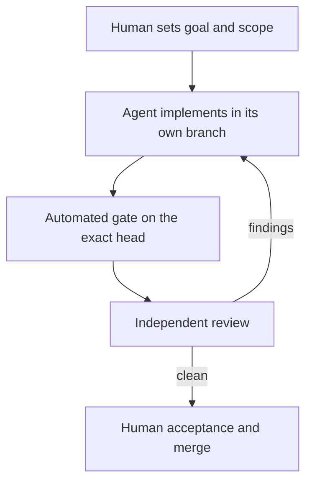

# AI-Assisted Delivery

The workflow and tooling I built for delivering software with coding agents, while keeping intent, review, and acceptance with a person.

## What I built

Everything below is public in my [AI-Assisted Engineering Playbook](https://github.com/wouthh/ai-assisted-engineering-playbook).

- **Repository-specific `AGENTS.md` workflows.** Each repository states its own scope rules, privacy limits, validation gate, and delivery steps, so an agent works to the project's contract instead of a generic prompt. The playbook holds the [template](https://github.com/wouthh/ai-assisted-engineering-playbook/blob/main/templates/AGENTS.template.md) I start from.
- **The `prloop` gate and review loop.** [`prloop`](https://github.com/wouthh/ai-assisted-engineering-playbook/blob/main/tools/prloop/README.md) is a dependency-free Node.js tool that moves pull requests through an external review bot. A plain script does the polling, gating, and syncing; a fresh coding agent starts only when there is real work (review findings, a conflict, a missing review request), handles that one step, and exits. It also shares one machine fairly between parallel gates through slot, load, and memory limits.
- **Change-scope and redaction checks.** The [change-scope check](https://github.com/wouthh/ai-assisted-engineering-playbook/blob/main/scripts/check-change-scope.py) fails when committed, local, or untracked changes leave a declared allowlist. The [redaction check](https://github.com/wouthh/ai-assisted-engineering-playbook/blob/main/scripts/check-report-redaction.py) scans reports for configured patterns without printing what it matched.
- **The Git identity guard.** The [identity guard](https://github.com/wouthh/ai-assisted-engineering-playbook/blob/main/docs/git-identity-guard.md) is a global Git hook that refuses commits, patches, and pushes with an unexpected author or committer email, and refuses commit messages that carry other addresses, such as co-author trailers an agent adds by default.

## The workflow

1. **Human intent.** I state the goal, constraints, allowed changes, protected material, and acceptance criteria.
2. **Agent implementation.** An agent explores and implements within that scope, in its own branch and worktree, following the repository's `AGENTS.md`.
3. **Automated gate.** The repository's documented gate runs on the exact pull-request head through `prloop ready`.
4. **Review.** An independent review bot reviews the current head; fix agents address findings until review converges.
5. **Human acceptance.** I decide whether the change merges and whether anything is published or deployed.

Diagram summary: a person sets the goal and scope, an agent implements it, the gate runs on the exact head, an independent reviewer either sends findings back to the agent or clears the change, and a person accepts and merges it.

## Design choices

- **Gate results belong to one head.** A passing gate counts only for the commit it ran on; any new commit needs a new run.
- **Agents are short-lived.** One agent per step keeps context small and makes each step reviewable on its own.
- **Guards fail closed.** The identity guard refuses an address it cannot match exactly against the allowlist, rather than letting it through.
