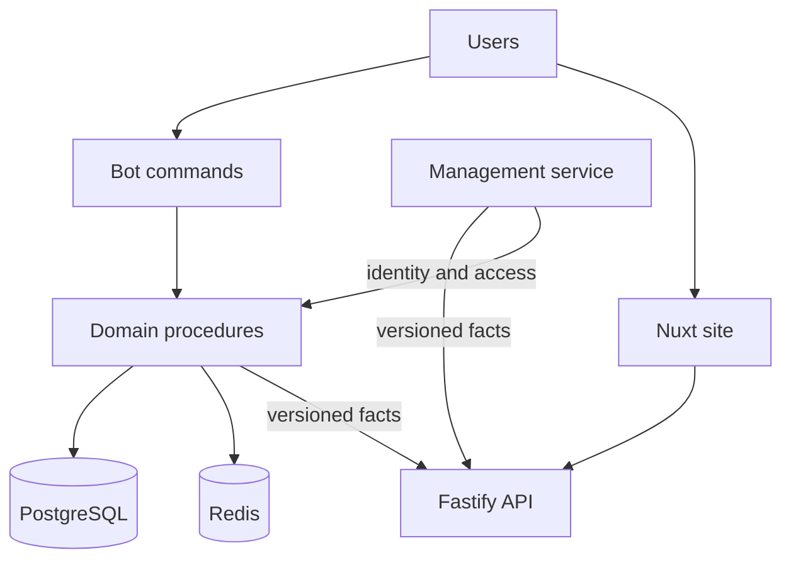

# A Modular TypeScript Platform

How I grew my main personal project, a TypeScript community platform, from one bot process into separate services without copying its rules into each one.

- **Stack:** TypeScript, Node.js, Fastify, Nuxt/Vue, PostgreSQL, Redis, Zod, Vitest
- **Source:** private personal project

## Context

The platform started as a single chat-bot service holding commands, scheduled jobs, persistence, and game rules in one codebase. Adding a website and an HTTP API created the usual risk: rules copied into route handlers or frontend code, and several components each claiming to know the current state.

I split it into three services with explicit owners:

- **The core service** owns domain rules, game and reward facts, and scheduled side effects.
- **A management service** owns identity, access, and other cross-cutting authority.
- **A web service** owns the Fastify API, the Nuxt site, and presentation storage.

No implementation import crosses a repository boundary. The services talk through versioned facts and signed, scoped service authentication, never shared runtime files.

Diagram summary: bot commands call domain procedures in the core service, which store state in PostgreSQL and Redis. The core and management services publish versioned facts to the web API, which the Nuxt site consumes. The management service provides identity and access to the core.

## Decisions

### One domain spine

Writes go through domain procedures in the core service. The website never duplicates game logic; it receives facts. Cross-cutting policy lives in small shared packages for configuration, event wording, and wire contracts. Every surface that announces an event derives its text from one canonical module, so a rule change happens in one place.

The web repository has a boundary check in its gate that rejects any import of the core service's implementation folders. Inside one repository I document allowed and forbidden imports in a header on each file.

<!-- QUESTION FOR WOUT: Inside the core repository, import direction is documented per file but not enforced by a lint rule. Is that a deliberate choice (for example, the header is aimed at agents and reviewers), or should the page say it is planned? -->

### Thin entry points

A command handler parses input, defers or responds, calls a service, and renders user-facing text. Domain rules live in tested services. One verification command, for example, is a short adapter that hands off to a shared core module. API routes resolve and authorize the viewer, apply rate limits, validate input against strict Zod schemas, and return a standard response envelope.

### Versioned contracts, no fallbacks

Wire schemas live in a contracts package: the response envelope, a fixed set of error codes, and the fact schemas each service publishes. Compatibility is handled with explicit versions (a literal contract version in each schema, and a version in the protocol name), not with fallback parsing. The web service keeps checked-in generated copies of these packages, and its gate verifies them by hash. I follow a single-path rule: no legacy branches or parallel implementations kept around for old shapes.

### Fail-closed operational gates

One operations switch controls every class of active side effect. Missing, blank, false, or unrecognized values all mean disabled. An explicit "on" is not enough either: the service also needs a durable operations epoch, and work left over from a closed period has to be rebased or cleaned up before it can run.

The guards sit at two layers. Registration-time guards keep paused schedulers from starting. Execution-time guards, checked again just before each side effect, cover queued work, direct service calls, admin commands, and CLI paths. The web service applies the same switch and falls back to archive views while operations are closed. The management service also has a shadow profile that suppresses every mutation and returns a typed "suppressed" result.

<!-- QUESTION FOR WOUT: What made you add the epoch requirement on top of the switch? A short reason (for example, preventing stale queued work from firing after a re-enable) would make this section stronger. -->

### Claims before side effects

A one-time side effect follows a fixed order: claim atomically in the database, commit, act, then record the result. A daily delivery has one claim per date, and only the current claimant may send. When a delivery's outcome is uncertain, it is stored as unknown and never replayed automatically. Each publisher keeps its own claim and deduplication, and role routines skip the write when the actual state already matches the desired state.

### Projections never win over facts

Each service's ownership is written down: game and reward facts belong to the core service, generic authority to the management service, presentation and its storage to the web service. Derived state, such as notification roles, is computed from the owning records. An unknown fact never removes an existing role, and a pending fact never counts as linked.

<!-- QUESTION FOR WOUT: Can the web service's read models be rebuilt from the core and management facts (for example, by replaying sync lanes)? I could not confirm a documented rebuild path. If yes, add one sentence on how; if no, the section should stay as is. -->

## Validation

Each repository has one documented gate.

- **Core service:** works out which stages a diff needs, starts throwaway PostgreSQL and Redis instances, and runs migrations, type checking, the Vitest suite, the build, and content checks. A strict mode runs everything.
- **Web service:** runs standalone and then paired against a separately built core service, covering type checks, builds, boundary and generated-artifact checks, migrations against two PostgreSQL major versions, and Redis store tests.
- **Management service:** includes a throwaway PostgreSQL integration lane. It runs a deliberately failing test to prove that failures propagate, and writes a receipt tied to the exact commit.

## What I learned

Modularity is an ownership decision, not a folder count. Splitting the services paid off only after I wrote down who owns each kind of truth and made every crossing a versioned contract. The other lesson is to design pausing and recovery together with the feature: schedulers, claims, and the operations switch are product behaviour, not infrastructure to add after the happy path.
