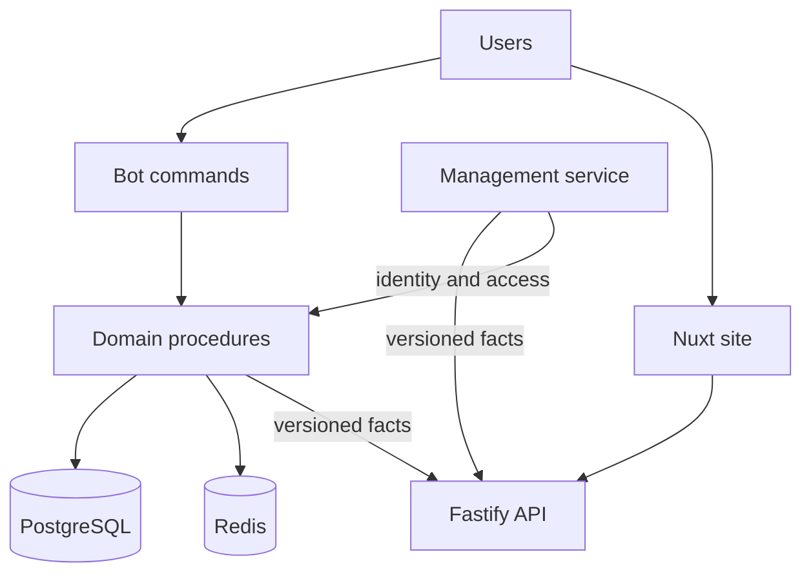

# A Modular TypeScript Platform

How I grew my main personal project, a TypeScript community platform, from one bot process into separate services without copying its rules into each one.

- **Stack:** TypeScript, Node.js, Fastify, Nuxt/Vue, PostgreSQL, Redis, Zod, Vitest
- **Source:** private personal project

## Context

The platform started as one chat-bot service holding commands, scheduled jobs, persistence, and game rules. Adding a website and an HTTP API risked rules being copied into route handlers and frontend code, with several components each claiming to know the current state.

I split it into three services with explicit owners:

- **The core service** owns domain rules, game and reward facts, and scheduled side effects.
- **A management service** owns identity, access, and other cross-cutting authority.
- **A web service** owns the Fastify API, the Nuxt site, and presentation storage.

No implementation import crosses a repository boundary. The services talk through versioned facts and signed, scoped service authentication.

Diagram summary: bot commands call domain procedures in the core service, which stores state in PostgreSQL and Redis. The core and management services publish versioned facts to the web API that the Nuxt site uses, and the management service provides identity and access to the core.

## Decisions

### One domain spine

Writes go through domain procedures in the core service; the website receives facts and never duplicates game logic. Shared packages hold configuration, event wording, and wire contracts, and every surface that announces an event takes its text from one module, so a rule changes in one place.

The web repository has a boundary check in its gate that rejects any import of the core service's implementation folders. Inside the core repository, files where ownership or a boundary matters carry a context header for agents and reviewers, listing purpose, dependencies, invariants, inputs and outputs, related components, and forbidden imports. Reviewers check import layering against those headers.

### Thin entry points

A command handler parses input, defers or responds, calls a service, and renders the reply; domain rules live in tested services. API routes resolve and authorize the viewer, apply rate limits, validate input against strict Zod schemas, and return a standard response envelope.

### Versioned contracts, no fallbacks

A contracts package holds the response envelope, a fixed set of error codes, and each service's fact schemas. Compatibility comes from explicit versions in each schema and protocol name, not fallback parsing. The web service keeps generated copies of these packages, verified by hash in its gate. I keep a single path: no legacy branches or parallel implementations for old shapes.

### Fail-closed operational gates

One operations switch controls every class of active side effect, and any value other than an explicit "on" means disabled. The switch expresses intent, while a durable operations epoch records whether operations are closed, reopening, or enabled, with timestamps and a readiness flag. Reopening suppresses, expires, or rebaselines work that accumulated while closed, without marking anything as sent just to silence it. Individual feature areas have their own epochs and reopen the same way. Missing or malformed epoch data counts as closed, and a restart never replays a completed transition.

Registration-time guards keep paused schedulers from starting, and execution-time guards, checked again just before each side effect, cover queued work, direct service calls, admin commands, and CLI paths. The web service shows archive views while operations are closed, and the management service has a shadow profile that suppresses every mutation with a typed "suppressed" result.

### Claims before side effects

A one-time side effect follows a fixed order: claim atomically in the database, commit, act, then record the result. A daily delivery has one claim per date, and only the current claimant may send. An uncertain outcome is stored as unknown and never replayed automatically, and role routines skip the write when the actual state already matches.

### Projections never win over facts

Derived state, such as notification roles, is computed from the owning records. The web service builds its game and membership views from authenticated owner facts plus its own state, and it is never an authority for gameplay or membership; it is authoritative only for its own profiles and sessions. An unknown fact never removes an existing role, and a pending fact never counts as linked.

## Validation

Each repository has one documented gate.

- **Core service:** picks the stages a diff needs, starts throwaway PostgreSQL and Redis instances, and runs migrations, type checks, Vitest, the build, and content checks; a strict mode runs everything.
- **Web service:** runs standalone and paired with a built core service, covering type checks, builds, boundary and generated-artifact checks, migrations on two PostgreSQL major versions, and Redis store tests.
- **Management service:** adds a throwaway PostgreSQL integration lane, proves that failures propagate with a deliberately failing test, and writes a receipt tied to the exact commit.

## What I learned

Modularity is an ownership decision, not a folder count: the split paid off only once I wrote down who owns each kind of truth and made every crossing a versioned contract. I also design pausing and recovery together with each feature, because schedulers, claims, and the operations switch are product behaviour.
