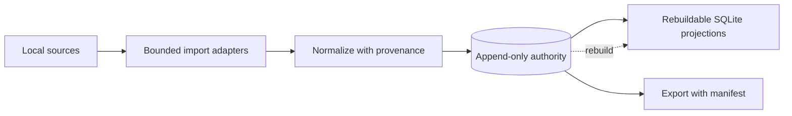

# Trustworthy Local Data Systems

Design decisions in two personal local-first tools I built: a Python archive with search and export, and a TypeScript event-history ledger. Both read a desktop application's local caches and stores, keep their data on the user's machine, and use SQLite.

- **Stack:** Python, PySide6, TypeScript, Rust (installer), SQLite (FTS5 and `node:sqlite`), pytest, Vitest, mypy, ruff, ESLint
- **Source:** private personal projects

## The problem

Local application data is partial. Caches rotate, older records disappear, timestamps describe when something was observed rather than when it was created, and two sources can describe the same event differently. If a tool treats every row as equally true, its search results and exports claim more than the evidence supports.

So I built both tools around one rule: retained evidence is the authority, and everything else is a projection that can be thrown away and rebuilt.

Diagram summary: local sources pass through bounded import adapters and normalization that records provenance, into an append-only authority layer. SQLite projections and exports derive from that layer, and projections can be rebuilt from it at any time.

## Decisions

### Append-only authority

In the archive, observations, media, and lifecycle events are append-only rows. Re-inserting a record that conflicts with an existing observation is refused instead of overwriting it. Edits and deletions are new evidence (an observed delete, an edited observation, a source-marked deletion), not updates in place.

In the ledger, the authority is a framed journal of finalized, immutable segments. I made the journal an integrity boundary independent of the query database: schema-versioned frames, monotonic sequence numbers, and previous-segment hashes make order and integrity checkable without SQLite, and the chain is tamper-evident. Segmenting bounds crash recovery and tail validation and lets the index catch up incrementally. A broken SQLite projection never means lost history. Malformed frames fail closed, and only a trailing partial frame, the signature of an interrupted write, may be truncated. A record disappearing from a store needs two observations before the ledger calls it gone; with one, its state is "unknown".

### Why two storage models

The archive processes bounded sources: local caches and imported exports. Append-only SQLite rows fit that, because SQLite gives transactional ingestion through a single writer, provenance-preserving rows, ordered migrations, and FTS5 search in one file.

The ledger captures continuous live events. Its framed, hash-linked journal is the durable capture boundary: a record is acknowledged once it is written to the journal, and a separate worker updates the SQLite projection afterwards, using the journal as its backlog. Capture does not wait for the index, and a projection that falls behind or fails does not lose an event. The cost is a second storage format, plus recovery code for interrupted tails, and I accepted that only for the live-capture tool.

### Projections are disposable

Search indexes and current-state tables are projections. In the ledger, the SQLite index states that the journal, not the index, is authoritative. It records its projection, journal, and sanitization versions, and a count receipt detects missing rows. Resetting the projection rebuilds it from the journal. In the archive, FTS5 tables serve search, a check flags authoritative rows newer than the derived projections, and a recovery command marks interrupted jobs incomplete, rebuilds derived indexes, and quarantines stale generated output. Both tools run SQLite integrity checks.

### Provenance and uncertainty in the data model

Every imported record carries where it came from: the scan, the store, the source record, the adapter, the observation time, and (in the archive) the parser version. Uncertainty is part of the schema, not a nullable column. The archive distinguishes exact from inferred authorship, lists inferred fields, and labels comparisons as conflicting, unresolved, or inconclusive, with a confidence level. Normalization reports complete, truncated, or malformed results. The ledger distinguishes omitted, null, empty, and present fields, and labels correlation results so that they never read as proof of identity.

### Bounded imports

Format detection reads only a bounded prefix of a candidate file, never the whole file. Imports have separate limits on source size, record count, and line length, and the archive commits in fixed-size batches so an interrupted import stops at a safe boundary. The ledger caps frame and manifest sizes.

### Deterministic migrations

Schema migrations must form a contiguous sequence, run inside one immediate transaction, and record the applied version. A database from a newer version of the tool is refused rather than partially rewritten. The ledger's projection upgrade runs in one transaction, so a failure leaves the previous version exactly as it was, and it never rewrites the journal.

### Exports state their limits

Archive exports carry a versioned manifest that declares exclusions, pseudonymization, exclusion counts, and every known limitation. An export never claims to be a complete history beyond its declared inputs.

### Privacy by default

Normalization redacts credential-like fields. Diagnostics cap their size and leave out message content, identifiers, paths, and tracebacks. Tests use synthetic fixtures only, and a privacy check in each gate rejects real-looking data in the repository. The ledger's gate also scans the working tree and history for secrets.

## Validation

Each tool has one local gate. The archive's gate runs ruff, the privacy check, mypy, and pytest in isolated caches. The ledger's gate runs formatting, ESLint, type checks, Vitest suites (unit, fixtures, integration, compatibility, privacy), the privacy and secret scans, and license checks; its Rust installer parts use cargo tests and clippy.

I keep packaging evidence separate from application behaviour. Linux packaging of the archive is verified locally; a Windows package run under Wine is labelled as Wine, not as native Windows validation.

## What I learned

Model evidence quality before building the browser. Provenance and uncertainty added later are always incomplete, because the first import already discarded the context. Privacy and testability also reinforce each other: synthetic fixtures make the suites shareable, and strict source boundaries keep both tests and runtime away from unrelated local data.
