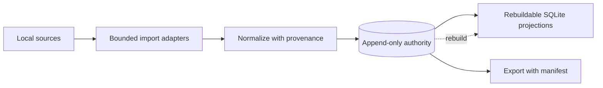

# Trustworthy Local Data Systems

Design decisions in two local-first tools I built: a Python archive with search and export, and a TypeScript event-history ledger. Both read a desktop application's local caches and stores, keep data on the user's machine, and use SQLite.

- **Stack:** Python, PySide6, TypeScript, Rust (installer), SQLite (FTS5 and `node:sqlite`), pytest, Vitest, mypy, ruff, ESLint
- **Source:** private personal projects

## The problem

Local application data is partial. Caches rotate, older records disappear, timestamps record observation rather than creation, and two sources can describe one event differently. A tool that treats every row as equally true overclaims in its search results and exports.

So I built both tools around one rule: retained evidence is the authority, and everything else is a projection that can be thrown away and rebuilt.

Diagram summary: local sources pass through bounded import adapters and provenance-recording normalization into an append-only authority layer, from which SQLite projections and exports derive and projections can always be rebuilt.

## Decisions

### Append-only authority

In the archive, observations, media, and lifecycle events are append-only rows. A conflicting re-insert is refused instead of overwriting, and edits and deletions are recorded as new evidence, not updates in place.

In the ledger, the authority is a framed journal of finalized, immutable segments. I made the journal an integrity boundary independent of the query database: schema-versioned frames, monotonic sequence numbers, and previous-segment hashes make order and integrity checkable without SQLite, and the chain is tamper-evident. Segmenting bounds crash recovery and tail validation and lets the index catch up incrementally. Malformed frames fail closed, and only a trailing partial frame, the signature of an interrupted write, may be truncated. A record disappearing from a store needs two observations before the ledger calls it gone; with one, its state is "unknown".

### Why two storage models

The archive processes bounded sources: local caches and imported exports. Append-only SQLite rows fit that, because SQLite gives transactional ingestion through a single writer, provenance-preserving rows, ordered migrations, and FTS5 search in one file.

The ledger captures continuous live events, so its journal is the durable capture boundary: a record is acknowledged once it is in the journal, and a separate worker updates the SQLite projection afterwards, using the journal as its backlog. Capture does not wait for the index, and a projection that falls behind or fails loses no event. The cost is a second storage format, plus recovery code for interrupted tails, and I accepted that only for the live-capture tool.

### Projections are disposable

Search indexes and current-state tables are projections. The ledger's index records its projection, journal, and sanitization versions, a count receipt detects missing rows, and a reset rebuilds it from the journal. In the archive, FTS5 tables serve search, a check flags authoritative rows newer than the derived projections, and a recovery command marks interrupted jobs incomplete, rebuilds derived indexes, and quarantines stale generated output. Both tools run SQLite integrity checks.

### Provenance and uncertainty in the data model

Every imported record carries its scan, store, source record, adapter, observation time, and in the archive its parser version. Uncertainty is part of the schema, not a nullable column. The archive separates exact from inferred authorship, lists inferred fields, and labels comparisons as conflicting, unresolved, or inconclusive with a confidence level. The ledger separates omitted, null, empty, and present fields, and labels correlations so they never read as proof of identity.

### Bounded imports

Format detection reads only a bounded prefix of a file. Imports have separate limits on source size, record count, and line length, and the archive commits in fixed-size batches so an interrupted import stops at a safe boundary. The ledger caps frame and manifest sizes.

### Deterministic migrations

Schema migrations form a contiguous sequence, run in one immediate transaction, and record the applied version. A database from a newer release is refused rather than partially rewritten, and the ledger's projection upgrade never rewrites the journal.

### Exports state their limits

Archive exports carry a versioned manifest that declares exclusions, pseudonymization, exclusion counts, and known limitations, so an export never claims more than its declared inputs.

### Privacy by default

Normalization redacts credential-like fields, and diagnostics are size-capped and leave out message content, identifiers, paths, and tracebacks. Tests use synthetic fixtures only, each gate rejects real-looking data in the repository, and the ledger's gate also scans the tree and history for secrets.

## Validation

Each tool has one local gate. The archive's gate runs ruff, the privacy check, mypy, and pytest in isolated caches. The ledger's gate runs formatting, ESLint, type checks, Vitest suites (unit, fixtures, integration, compatibility, privacy), the privacy and secret scans, and license checks; its Rust installer parts use cargo tests and clippy.

Linux packaging of the archive is verified locally; a Windows package run under Wine is labelled as Wine, not as native Windows validation.

## What I learned

Model evidence quality before building the browser: provenance added later is always incomplete, because the first import already discarded the context. Privacy and testability reinforce each other, since synthetic fixtures make the suites shareable and strict source boundaries keep tests and runtime away from unrelated data.
